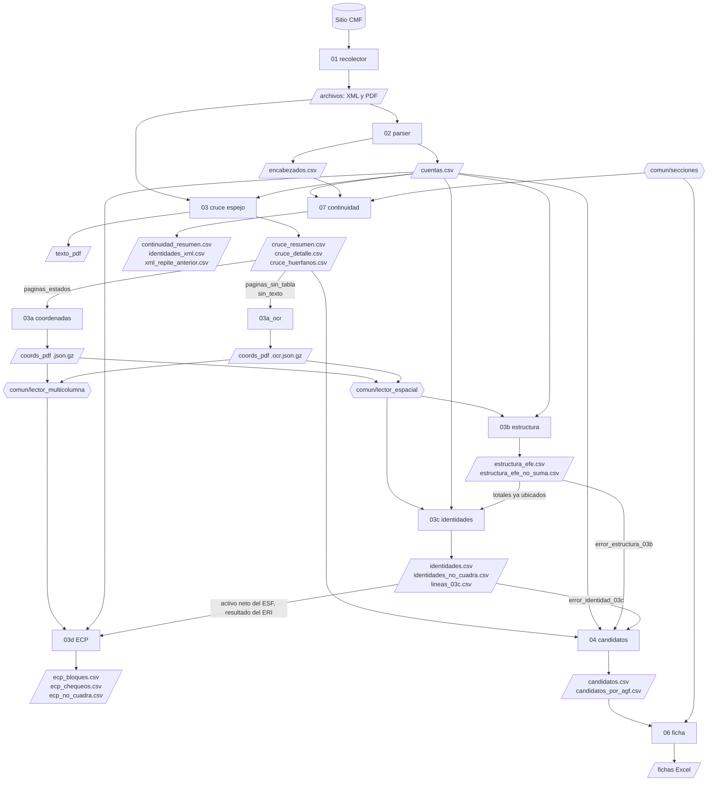

# Mapa del proyecto

Qué lee y qué escribe cada etapa, qué módulos comparten y qué hay que volver a correr o actualizar cuando algo cambia.

## Flujo de datos

Todo lo que está entre `/ /` vive en `CMF_HOME` (fuera del repo): `archivos/`, `texto_pdf/`, `coords_pdf/` y `procesado/`.

## Módulos compartidos

| módulo | qué hace | lo usan |
|---|---|---|
| `config.py` | rutas (`CMF_HOME`, `RAIZ`), materialidad por moneda, `casos_conocidos(etapa)` | todos |
| `comun/lector_espacial.py` | reconstruye líneas (glosa, actual, anterior) desde coordenadas; une la caché del 03a con la del OCR; reconoce el balance de apertura de 2011 | 03b, 03c, herramientas |
| `comun/lector_multicolumna.py` | lee estados con N columnas (ECP: una por serie + Total), corta bloques por período | 03d |
| `comun/ocr.py` | rasteriza y pasa Tesseract | 03a_ocr |
| `comun/secciones.py` | asigna ESF/ERI/ECP/EFE a cada código del XML según su orden (anclas) | 07, 06 |
| `03b_estructura.py` | además de ser etapa, entrega `SUBTOTALES`, `norm` y `TOL` | 03c, revisar |

## Qué volver a correr cuando cambia algo

| si cambias… | corre | y revisa |
|---|---|---|
| `02` (parser) | todo desde 02 | casos conocidos del 03b, 03c y 07 |
| `comun/lector_espacial.py` | 03b → 03c → 03d → 04 | casos conocidos del 03b y 03c; tablas del 03b y 03c en el README |
| `03b` | 03b → 03c → 04 | tabla del 03b y hallazgo de método 1 en el README |
| `03c` | 03c → 03d → 04 | tabla del 03c y hallazgo de método 1 en el README |
| `03d` o `comun/lector_multicolumna.py` | 03d | casos conocidos del 03d; sección del ECP en el README |
| `comun/secciones.py` | 07 (y 06 cuando generes fichas) | tabla de continuidad en el README |
| `07` | 07 | tabla de continuidad y párrafo de las validaciones de la CMF en el README |
| `04` | 04 | tabla del cruce espejo en el README |

`run.py --desde <etapa>` corre una etapa y todo lo que viene después.

## Dónde vive cada cosa

| qué | dónde | versionado |
|---|---|---|
| resumen público y cifras | `README.md` | sí |
| registro de decisiones y hallazgos (H, D) | `verificacion/decisiones_privado.md` → `anonimizar_docs.py` → `docs/decisiones.md` | solo la versión pública |
| casos de regresión (por etapa: 03b, 03c, 03d, 07, 07r) | `verificacion/casos_conocidos.csv` | no |
| evidencia de revisión manual | planillas `.xlsx` en `verificacion/` | no |
| scripts de muestras | `verificacion/muestra_*.py` | no |
| herramientas de diagnóstico y revisión | `herramientas/` (`diag_coords`, `diag_ecp`, `revisar`, `muestra_04`) | sí |

## Rutina de cierre

1. Editar solo `verificacion/decisiones_privado.md` (nunca `docs/decisiones.md`).
2. `python verificacion/anonimizar_docs.py && python verificacion/limpiar_codigo.py`
3. Revisar que las cifras del README coincidan con la última corrida (ver tabla de arriba).
4. `git add -A && git commit -m "..." && git push`